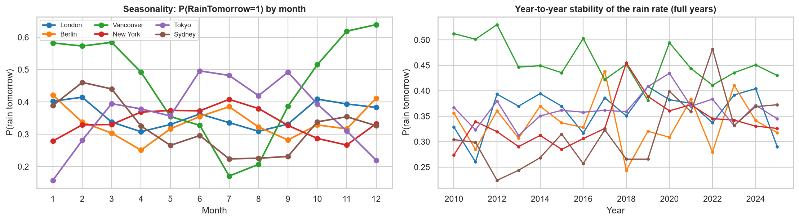
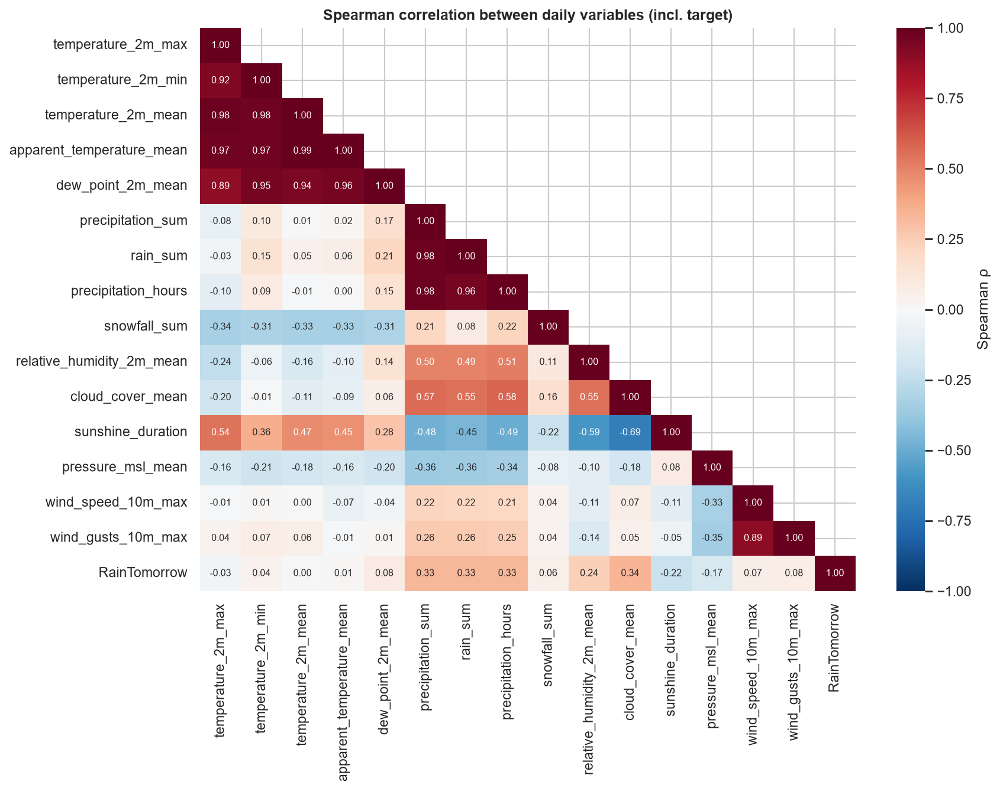
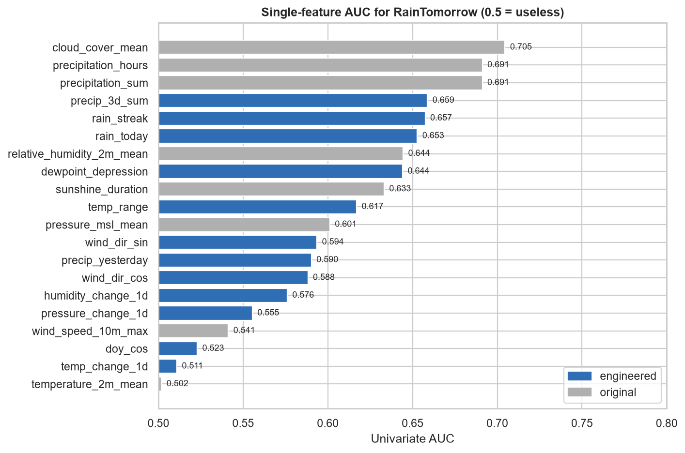
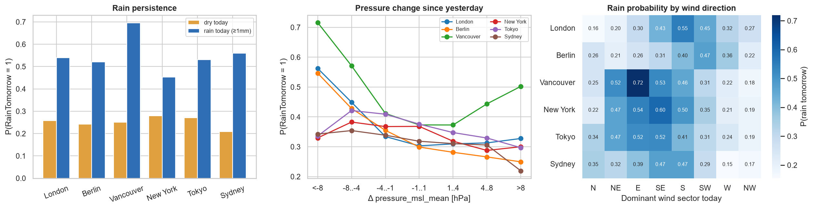

# RainTomorrow: Weather Data Pipeline for Machine Learning

### Project Overview
Will it rain tomorrow? This project builds the dataset for a binary classification model: `RainTomorrow = 1` if the next day's precipitation is at least 1.0 mm.

The data covers **36,000+ daily weather records** from **6 cities** (London, New York, Sydney, Berlin, Tokyo, Vancouver) between 2010 and 2026, collected from the Open-Meteo Historical Weather API.

> Part A (data collection, sensing and dataset creation) is complete. Part B (modeling) is in progress.

### Pipeline
1. **Data collection (`data_collection.py`):** Downloads raw JSON from the API with rate limiting (per minute, hour and day), retries with exponential back-off, and caching, so re-runs only fetch missing files.
2. **Sensing (`sensing.py`):** Converts the raw JSON files into one table per (city, date) and builds the target label from the next day's precipitation. The next-day value is used only for the label, never as a feature.
3. **Data understanding and preparation (`dataset_creation.ipynb`):** Data-quality checks, distributions, seasonality, correlations, expected and unexpected relations, feature AUC and feature engineering.

### Example Figures
| | |
|---|---|
|  |  |
|  |  |

### Repository Structure
```
data/raw/          102 raw API responses (city_year.json)
data/processed/    final_dataset.csv and prepared_dataset.csv
figures/           charts created by the notebook
report/            Part A report (Hebrew, PDF)
```

### How to Reproduce
```bash
pip install -r requirements.txt
python data_collection.py   # downloads only files that are missing
python sensing.py           # builds the final dataset
jupyter nbconvert --to notebook --execute --inplace dataset_creation.ipynb
```

### Tech Stack
Python, Pandas, NumPy, Matplotlib, Jupyter, REST API

*Course project ("Machine Learning"), built as part of a team.*
